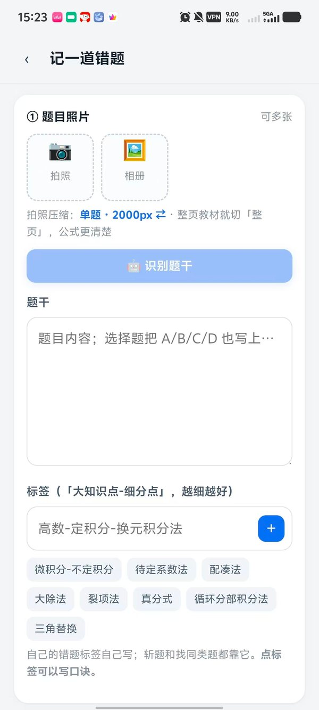
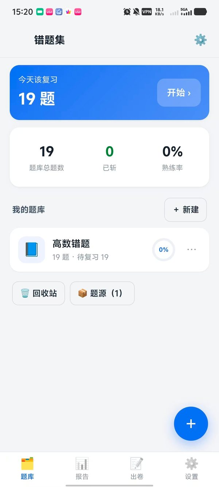
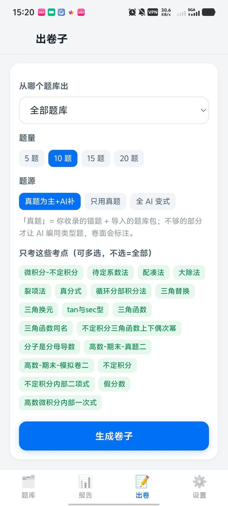
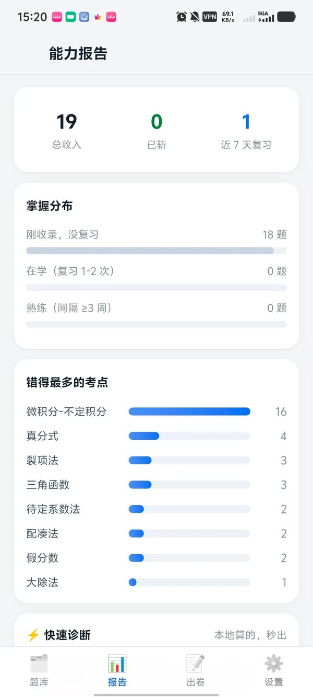

# 错题集 · Cuoti

> 拍一张，它替你记着。

一个**本地优先**的错题本：把错题拍照或粘贴进来，按遗忘曲线安排复习，会的斩掉、不会的反复出现，还能照着错题出变式卷。

- 数据全部存在你自己的设备里，没有账号、没有服务器
- 数学公式用 LaTeX 存储并渲染，长分数、积分、矩阵都能正常排版
- AI 只负责「认字」和「讲题」，用谁的、花多少钱由你自己决定
- 网页版 + Android APK 两套壳，共用同一份前端

<!-- 换成你自己仓库的地址 -->
[](https://github.com/Yanh658/mistakes-note/actions/workflows/android.yml)

## 截图

<table>
  <tr>
    <td></td>
    <td></td>
  </tr>
  <tr>
    <td align="center">拍照或相册录入，自动框选题干</td>
    <td align="center">今天该复习哪些，一眼看到</td>
  </tr>
  <tr>
    <td></td>
    <td></td>
  </tr>
  <tr>
    <td align="center">按考点组一套变式卷</td>
    <td align="center">错得最多的考点，本地算的</td>
  </tr>
</table>

## 功能

**录入**
- 拍照 / 相册，自动框选题目区域，支持旋转和裁剪
- 粘贴文本直接入库
- AI 识别：把照片转成题干 + LaTeX 公式，自动打知识点标签
- 每个标签可以写自己的口诀，复习时能看到

**复习**
- 间隔重复（SRS）：今天该复习哪些题，它说了算
- 斩题：真会了就从复习里消失，15 天内在回收站可以捞回来
- 分类、筛选、搜索、统计（正确率 / 热力图 / 分库统计）

**练习**
- 出卷：从自己的题库 + 题源里组卷，也可以让 AI 出变式题
- 内置题源：同济高数上册 283 题 / 下册 480 题 / 期末真题 170 题 / 四六级词汇

## 怎么用

### 一、装上就能用（推荐）

去 [Releases](https://github.com/Yanh658/mistakes-note/releases) 下最新的 APK 装到手机。
Android 8.0 及以上。装完在「设置」里填上自己的 API Key 就能识图。

### 二、电脑上跑网页版

```bash
cd web
python3 serve.py 8090
# 打开 http://127.0.0.1:8090
```

`serve.py` 同时做两件事：静态文件服务，以及把浏览器发往大模型 API 的请求转发出去（绕过 CORS）。
网页版需要它；**装成 APK 之后就不需要了**。

### 三、自己构建 APK

```bash
cd android
./gradlew assembleDebug
# 产物：android/app/build/outputs/apk/debug/app-debug.apk
```

需要 JDK 17 + Android SDK 35。Windows 上的坑（尤其是中文用户名）见 [docs/本地构建.md](docs/本地构建.md)。

## 数据与隐私

值得说清楚，因为这决定了你敢不敢往里放真东西：

| 东西 | 在哪 |
|---|---|
| 题目、图片、复习记录 | 你自己设备的 IndexedDB / App 私有目录，不上传 |
| API Key | 同样存在本地，设置页只显示前几位 |
| AI 请求 | 从你的设备直接发给你填的那家服务商，没有中间人 |
| 崩溃统计 / 埋点 | **没有**，一个都没有 |

网页版是唯一需要「服务器」的形态：如果你把它部署到公网，那个 `/proxy` 会转发你的
AI 请求（不记录 Key，也不落盘）；但它毕竟在中间，介意的话请用 App 或本机网页版。

## 配置 AI

在「设置」里填三项即可（兼容所有 OpenAI 兼容接口）：

| 项 | 例子 |
|---|---|
| API 地址 | `https://api.deepseek.com/v1` |
| API Key | `sk-...` |
| 模型名 | `deepseek-chat` |

识图需要能看图的模型（如智谱 `glm-4v-flash`、阿里 `qwen-vl-plus`），文字解析用便宜的就够。
**不配置也能用**：拍照只存图，题干手动粘贴。

## 技术栈

- 纯前端，单文件 `index.html`，无构建步骤
- KaTeX 本地渲染公式（离线可用）
- IndexedDB 存储，Service Worker 离线缓存
- Android：WebView 壳 + `WebViewAssetLoader`（用 `appassets.androidplatform.net` 这个
  https 来源，IndexedDB / SW 才可用），AI 请求走 Java 层原生通道
- 可选后端：Cloudflare Worker（静态托管 + `/proxy` 转发），见 [web/部署说明.md](web/部署说明.md)

## 目录

```
web/        纯前端（可直接部署，也会被打进 APK 的 assets）
  index.html    主程序（单文件，含全部逻辑）
  intro.html    介绍页
  packs/        内置题库包
  vendor/katex/ 本地 KaTeX
  serve.py      本地静态服务 + AI 代理（仅开发用）
  worker.js     Cloudflare Worker（静态资源 + /proxy）
android/    Android WebView 壳（Gradle 工程）
  app/src/main/java/com/cuoti/app/MainActivity.java
  app/src/main/assets/    打包进去的网页（= web/ 的副本，用脚本同步）
scripts/    小工具
docs/       文档
```

## 开发

```bash
# 改了 web/ 之后，同步进 APK 的 assets（CI 会检查这一步）
python3 scripts/sync_assets.py

# 发版前要同步三处版本号
#   web/index.html  : const APP_VER = 'v28'
#   web/version.json: {"v":"v28"}
#   web/sw.js       : const VER = 'cuoti-v28'
```

更多细节：[docs/开发笔记.md](docs/开发笔记.md)（架构、踩过的坑、为什么要这么写）。

## 免责声明

这是个**个人项目**，用业余时间写的，不是公司产品。

- **Issue / PR 随缘处理**。看到会看，但不保证响应时间，也不保证都会修。提问前建议先翻一下 [docs/开发笔记.md](docs/开发笔记.md) 和已有 issue。
- **软件按「现状」提供**，不附带任何担保，也不对使用后果负责。这条与 [LICENSE](LICENSE) 里的 MIT 条款一致。
- **AI 识别的结果可能出错**：公式可能被认错、解析可能跑偏。重要作业和考试请自己核对，别把它的输出当唯一依据。
- **数据在你自己的设备上，没有云端备份**。作者没有你的数据，也没法帮你找回。换手机、清缓存、卸载重装之前，请先在 App 里「导出备份」。
- **AI 服务的费用和合规由你自己负责**：用哪家、花多少钱、内容是否合规，都取决于你在设置里填的那个服务商。

## 许可

MIT，见 [LICENSE](LICENSE)。
